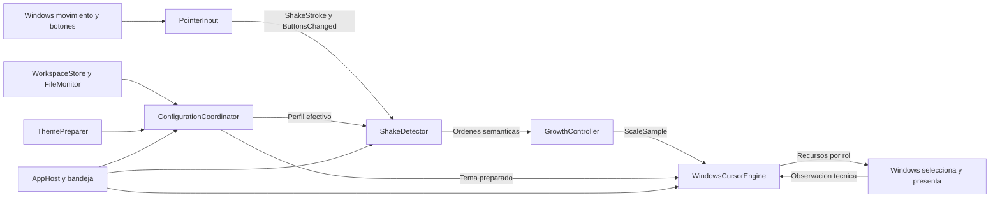
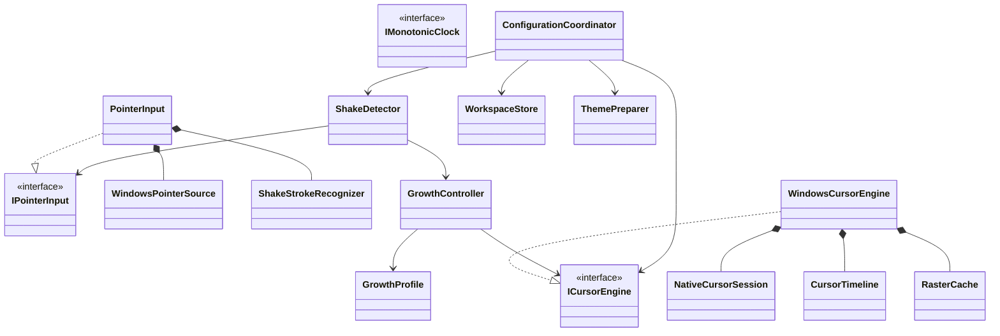
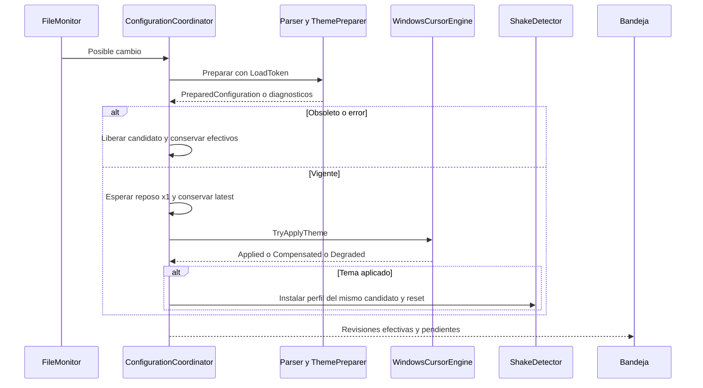
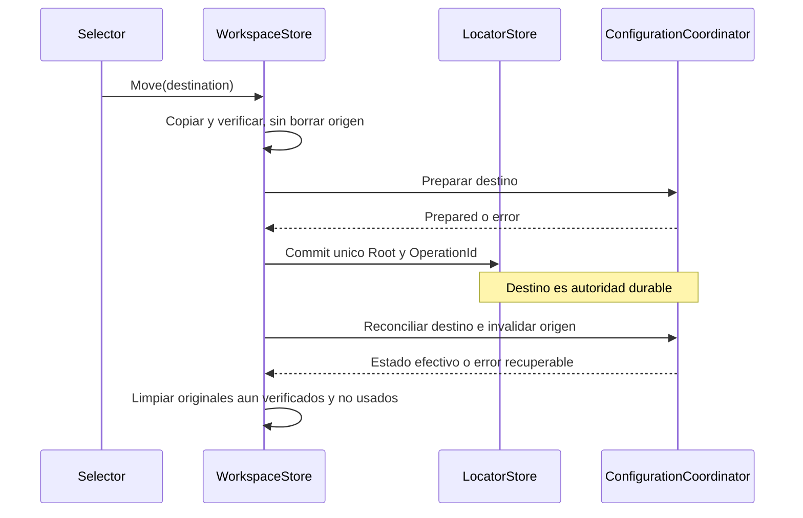
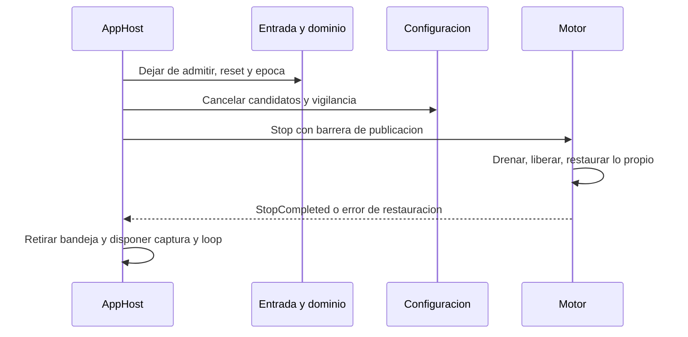

# CursorShake — arquitectura

Especificación vigente, 26-oct-2026. Ejecutable autónomo e instalador implementados; QA real temporal autorizada con restauración de los cambios personales. Acuerdos funcionales adoptados; detalles técnicos y pruebas pendientes se identifican en su sección. Recibo vigente de revisión y límites de la validación en apartados9 y11.

Referencias: [configuración inicial y reglas](ConfiguracionInicial.md), [experiencia de usuario](ExperienciaUsuario.md), [equivalencias y procedencia](EquivalenciasCursores.md). No duplicar tablas ni convertir propuestas en acuerdos por repetición.

## 1. Acuerdos y simplificación central

C#, bandeja, tema permanente y crecimiento por sacudidas. Sin CLI de producto, gestos generales, plugins, scripts externos, interceptar clics ni mover el puntero. El usuario dirige el dominio; la integración Windows se concreta dentro de esos límites.

Entrada traduce movimiento y botones a objetos semánticos. **ShakeDetector es el controlador del gesto**; decide estados y dirige GrowthController. GrowthController calcula la evolución solicitada y comunica escala al motor. AppHost compone y termina, no dirige cada movimiento.

**Windows selecciona el rol, coloca, muestra y oculta el cursor.** Preparamos un mapa completo por tema y publicamos recursos nativos con reloj propio de fotogramas para escalar sin reiniciar ANI. Observar rol/identidad/visibilidad/DPI sigue siendo necesario, pero queda dentro del motor.

No hay controlador contextual por hover ni fachada de renderer adicional. Observación nativa y publicación pertenecen al motor, un módulo con auxiliares, no una clase dios. No se promete controlar cursores privados o dibujados por aplicaciones.

Los límites de presentación y las políticas de compatibilidad se definen en el apartado 4; los valores y reglas del gesto, únicamente en ConfiguracionInicial.

## 2. Componentes y dependencias



| Componente | Ownership | Colaboradores internos |
| --- | --- | --- |
| AppHost | Composición, instancia, sesión, arranque/cierre y comandos de bandeja. | TrayApplicationContext/TrayView, StartupRegistration, SessionMonitor y coordinación de RecoveryGuard. |
| RuntimeLoop | Estado serial, admisión ordenada y próximo despertar. | Reloj monótono y adaptador de espera/dispatch. No decide reglas. |
| PointerInput | Traducción semántica, botones y preparación de tramos. | WindowsPointerSource captura; ShakeStrokeRecognizer reconoce inversiones. |
| ShakeDetector | Cuenta, bloqueo, fase semántica y fechas de cambio. | GrowthController y perfil efectivo; máquina compacta, sin clase por estado. |
| GrowthController | Única evolución de escala y avance de curva. | GrowthProfile como valor/funciones. No decide umbral de activación. |
| WindowsCursorEngine | Tema instalado, escala, activación de rol y reloj visual. | NativeCursorSession, CursorTimeline, RasterCache. |
| ConfigurationCoordinator | Revisiones deseadas/preparadas/efectivas y diagnósticos; pipeline único. | Parser, validador, ThemePreparer concretos. Sin fachada adicional. |
| WorkspaceStore | Ubicación, plantilla, lectura/escritura y traslado recuperables. | FileMonitor, LocatorStore y operaciones separadas de escritura/traslado. |
| ThemePreparer | Resolver mapa y fallback, verificar y preparar fuentes. | CursorAssetLoader, decodificadores/rasterizador; no modifica Windows. |

Cada fila es responsabilidad, no archivo único. No fusionar parser/traslado/captura/presentación para reducir nombres. Tres puertos aíslan dominio: **IPointerInput**, **ICursorEngine**, **IMonotonicClock**. Sin interfaz por helper, bus global, IFileSystem genérico ni contenedor de inyección obligatorio. El motor tiene API semántica aunque internamente conozca Windows.



## 3. Contratos y estado serial

Son especificaciones, no contratos compilados. No exponer handles/eventos Win32 al dominio.

| Dato | Campos necesarios / consumidor |
| --- | --- |
| Instant / Duration | Base monótona común / duración. Calendario solo en diagnóstico. |
| ShakeStroke | OccurredAt: instante de admisión de la muestra que CONFIRMA una inversión válida, no el extremo retrospectivo. Cuenta/cadencia usan esta base común; PeakAt puede quedar en diagnóstico del reconocedor. Geometría no viaja al crecimiento. |
| ButtonsChanged | Instante, conjunto izquierdo/central/derecho y transición. Detector bloquea hasta soltar todos. |
| GestureProfile | Reconocimiento, cuenta, tiempos y GrowthProfile; una identidad para todo el conjunto efectivo. Defaults en documento propio. |
| GrowthDrive | Cadencia interpretada por detector o ausencia explícita. No movimientos/contador para reinterpretar activación. |
| ScaleSample | Scale≥1, instante de evaluación y GestureEpoch; máximo del perfil de ese gesto. |
| PreparedTheme | Mapa completo, fuentes/timings/hotspots, revisión y ownership transferible. |
| LoadToken | LifecycleEpoch, WorkspaceGeneration, ContentRevision, ResourceRevision. No contador genérico que oculte qué invalida. |
| ConfigurationStatus | Revisión deseada/preparada, configuración efectiva/pendiente (tema y perfil juntos) y diagnósticos. |

### 3.1. Bucle, próximos plazos y captura

RuntimeLoop posee dominio y commits lógicos. Componentes ofrecen Advance(now) y NextDeadline; se despierta en el menor plazo o entrada. Sin timer/callback cancelable por clase ni giro continuo sin plazos. UI recibe estado por dispatcher, nunca llamadas desde worker arbitrario.

Captura nativa breve, con hilo de mensajes dedicado si hace falta. Admisión serial asigna secuencia e instante común; movimiento, botones y discontinuidades se procesan en ese orden. No reducir movimiento a una posición por fotograma. Transporte acotado: pérdida/atraso incompatible resetea tramo/cuenta y resincroniza, no inventa activaciones. No se promete preservar tiempo físico no observado. Cola y atraso admitidos serán límites explícitos medidos.

Lectura/preparación y rasterización salen del bucle. Commit serializa mutaciones de presentación. Una API nativa puede tardar: se mide y luego se procesan entradas admitidas; nunca bloquear la captura esperando rasterizar.


Contrato temporal: PointerInput reconoce en el RuntimeLoop, sobre muestras admitidas en FIFO. OccurredAt de ShakeStroke es la marca de admisión de la muestra que confirma el tramo invertido; no se reconstruye una orden de dominio en el extremo anterior. Las trazas del medidor conservan extremos retrospectivos: su calibración de130ms es punto de partida, y habrá que contrastar la cadencia entre confirmaciones con el reconocedor definitivo. No fingir equivalencia perfecta de ambos relojes ni cambiar130ms automáticamente.

Advance(occurredThrough, applyAt) mantiene un horizonte semántico monotónico separado del instante de evaluación; Advance(now) equivale a ambos argumentos iguales. La finalización lógica de retorno/preview pertenece al detector, y no se deduce de que una evaluación física adelantada haya llegado ya a ×1.

El bucle distingue **tiempo de ocurrencia/admisión**, usado para intervalos, de **ApplyAt**, tomado del reloj monótono al procesar una orden y nunca menor que el último ApplyAt. No calcular una curva en el pasado. Wake/plazos entran por la misma admisión FIFO; antes de un mensaje se resuelven los vencidos estrictamente anteriores a su marca, y las coincidencias siguen la política de prioridades aceptada en ConfiguracionInicial. Un prefijo admitido tiene orden determinista; el handler no adelanta plazos por delante de mensajes ya admitidos solo porque ahora el reloj de pared monótono sea mayor.

Los comandos temporales reciben RuntimeCommandTime(OccurredAt, ApplyAt) desde la cola; no consultan clock.Now para sustituir la admisión. Preview y cambio de perfil aceptan ambos tiempos. Reset y suspensión usan el tiempo físico sin consumir por adelantado el horizonte semántico. El overload sin contexto queda para consultas. Los botones atrasados conservan su marca admitida aunque la cancelación visual se aplique ahora; no se inserta un Advance inclusivo delante del input. Una regresión de occurredThrough sigue siendo error y no se oculta ajustando el timestamp.

Si una fuente trae una marca anterior al watermark de ocurrencia ya consumido, hay reordenación/pérdida o atraso superior al presupuesto de admisión, el dueño de admisión declara discontinuidad: reset coordinado de tramo/cuenta y resincronización, sin replay ni restaurar una cuenta ya vencida. Una pulsación tardía se procesa a ApplyAt actual y bloquea/reduce, nunca se pierde para evitar discontinuidad. El valor del presupuesto de atraso queda para medición; su propietario y resultado están fijados. Un retraso tolerado conserva OccurredAt para cadencia y aplica órdenes a ApplyAt actual, no retroactivamente.

### 3.2. Gesto y crecimiento

ShakeDetector posee Idle/Counting/Growing/Holding/Returning/Blocked; GrowthController solo evolución matemática ordenada. No dos máquinas deciden fin/rearme. Finalización de retorno vuelve al detector con GestureEpoch; épocas viejas no cambian fase.

Órdenes: BeginGrowth(drive,now), UpdateDrive(drive,now), Hold(now), Return(now), Advance(now). Antes de orden se evalúa escala actual, sin saltar a×1. Reglas en ConfiguracionInicial.

Down limpia primero tramo de entrada y después cuenta, reduce y bloquea mientras haya botones. Inicio/reanudación toma snapshot de botones antes de habilitar. Pausa, pérdida/sesión y cambio efectivo de reconocimiento limpian ambas memorias. Solo ShakeDetector consume input semántico; lifecycle/configuración coordinan su reset sin otro controlador del movimiento.

### 3.3. Perfil efectivo y reconfiguración

DesiredConfiguration es último candidato válido; EffectiveConfiguration contiene tema y perfil efectivos. EffectiveGestureProfile tiene identidad común para PointerInput, ShakeDetector y GrowthController.

Preparar inmediatamente y conservar un pendiente latest. Aplicar TODO el candidato al llegar a ×1, en un turno serial: publicar tema e instalar perfil coherente; resetear tramo/cuenta. Un fallo conserva/compensa conjunto anterior sin activar solo perfil. UI distingue configuración efectiva y pendiente. Win32 conserva límites de atomicidad de 5.1.

## 4. Motor nativo y recursos

API: SetScale(ScaleSample), TryApplyTheme(PreparedTheme), Suspend y Stop/Restore. GrowthController solo usa SetScale; composición usa las otras operaciones. No lee TOML ni interpreta movimiento.

NativeCursorSession posee baseline, identidades compartidas/propias, observación y publicación. CursorTimeline es lógica temporal interna, no controlador del contexto de aplicaciones. Windows selecciona/presenta; el motor transforma dibujo/hotspot y no fuerza SetCursor ajeno.

Cambio de rol conserva escala/fase de crecimiento y empieza fotograma0 de nueva activación. Repetir rol, mutación propia, movimiento o escala no reinician. Roles inactivos se preparan para reentrada. Observar transiciones muy breves no está garantizado. HCURSOR privado no se clasifica por parecido; Hidden≠Unknown. Sin overlay/ShowCursor para ampliar compatibilidad sin aprobación.

### 4.1. Preparación y fallback

ThemePreparer resuelve mapa completo una vez: asociación específica→predeterminado del tema→catálogo estándar Windows del mismo rol. Asociación existente inválida es error, no ausencia. Validar tema seleccionado completo, no solo rol visible. Un tema inactivo inválido puede figurar no disponible y se prepara al solicitarlo.

Loader valida dimensiones, formato, frames, duraciones y hotspots antes de entregar ownership. Los cuatro formatos y sus metadatos se definen exclusivamente en [FormatosCursores](FormatosCursores.md). CursorAssetLoader los normaliza a fuentes, hotspots y pasos temporales. Retener instrucciones vectoriales y rasterizar al tamaño final; CUR/ANI raster no adquieren resolución adicional.

Windows del catálogo y último fallback significan apariencia estándar Windows/Aero. Para Wait/Working se acepta la recreación geométrica propia; los otros roles requieren verificar fuente y fidelidad. El baseline de restauración es el esquema real anterior a CursorShake, que puede ser otro tema. Ejemplo: Bibata externo previo → elegir Windows muestra Aero → salir restaura Bibata. La referencia estándar no se obtiene recapturando nuestras propias sustituciones. No redistribuir imágenes propietarias de Windows.

NativeCursorSession distingue recursos propios, externos y desconocidos. Ante cambio externo detectado cede control, pausa mutaciones y no restaura encima. Reanudar requiere una referencia coherente; no capturar un mapa híbrido como nuevo baseline. No existe garantía de compare-and-swap de SetSystemCursor ni compatibilidad con dos gestores modificando el esquema a la vez.

### 4.2. Progreso sin backlog

HardEpoch cambia por lifecycle, tema/recurso, activación de rol o DPI incompatible. **Escala nueva y avance del tiempo NO invalidan por sí solos un trabajo.** Un activo y un destino latest. Un resultado compatible se publica aunque haya nuevas escalas; medir latencia e iniciar luego destino vigente. Así hay progreso con trabajos de40ms y solicitudes cada16,7ms.

Cambio duro descarta/libera resultado. Cambios duros continuos pueden impedir publicar un contexto ya desaparecido; no crean cola. Reloj absoluto: saltar pasos vencidos no reinicia/frena animación lógica. Preparación/publicación tiene latencia; no se promete exactitud infinita de cada frame bajo carga.

### 4.3. Presupuesto aceptado y ownership

| Recurso/límite | Dueño/regla |
| --- | --- |
| 2048px físicos/lado | Preparar conjunto de roles a máximo/DPI aplicable. No recortar cada rol con min que cambie multiplicador. |
| Hasta60Hz escala | Techo/objetivo visual, no captura ni velocidad ANI; sin ticks de escala estable. |
| Caché raster64MiB | RasterCache cuenta imágenes retenidas, incluidas copias nativas estimables; reserva antes de insertar y expulsa sin uso. No contar solo referencias managed. |
| Trabajo gráfico | Uno activo+destino latest; liberar resultados obsoletos antes de admitir reemplazo. |
| Preparación configuración | Un candidato activo+descriptor latest, independiente del gráfico. Cancelación cooperativa no inicia candidatos nuevos hasta liberar anterior. |
| Temas | Admisión explícita de bytes fuente, frames y representación vector/decodificada; contar baseline/activo/candidato/compensación. Cuotas de admisión implementadas en FormatosCursores, distintas de la caché raster. |
| Temporales | Medir filtros/copias y reservar presupuesto propio. Concurrencia acotada no garantiza memoria total acotada. Rechazar admisión que exceda presupuesto. |
| Handles | SafeHandle/lease nativo. LoadCursor compartido no se destruye; SetSystemCursor consume copia propia. Toda cancelación tiene dueño. |
| Baseline | NativeCursorSession captura esquema previo para restaurar; fallback usa catálogo Windows estándar. Ceder ante cambios externos, según 4.1. |

ARGB2048² cuesta16MiB solo en píxeles;54frames=864MiB. No precalcular combinaciones ilimitadas. Si no alcanza capacidad, reducir frecuencia conservando fuente/calidad, sin estirar miniaturas ni quitar sombras. Medir reposo, carga sostenida y DWM/GPU antes de afirmar consumo del producto.

### 4.4. DPI, visibilidad y sesiones

El tamaño normal sigue el escalado Windows y se conserva el multiplicador configurado. Validar máximo para todos los monitores conectados. Si aparece un contexto/DPI que excedería el límite físico, bloquear crecimiento allí, mantener representación segura y retornar antes de adoptar el nuevo tamaño normal. Avisar una vez con máximo compatible; no editar TOML ni recortar roles individualmente. Rearmar al recuperar compatibilidad. La transición nativa entre DPI requiere pruebas del producto.

Cursor privado/desconocido: conservar dibujo de la aplicación, cancelar gesto y normalizar roles propios sin imponer selección. Cursor oculto: no mostrarlo ni admitir activaciones. Reentrada visible/conocida en ×1 requiere activación completa. Bloqueo, suspensión o cambio de usuario resetean el gesto; normalizar si escritorio permite, o diferir. No operar sobre escritorio seguro.

Una instancia por sesión interactiva, con exclusión por usuario para mutaciones de workspace compartido. Plataforma inicial objetivo: consola local Windows 11 x64; efecto desactivado en contextos remotos/no certificados. La validación nativa descrita abajo cubre este equipo; no certifica todas las sesiones, monitores o drivers.

## 5. Configuración: un coordinador, dos productos

ParsedConfiguration contiene documento tipado/origen/diagnósticos. PreparedConfiguration añade validación y recursos. Active es ownership/estado, no cuarto modelo clonado. Applying/Degraded describen operación y no se confunden con qué tema/perfil es efectivo.

Pipeline único de arranque/watcher/bandeja: localizar→asegurar archivo→leer→parsear entero→validar→preparar→comprobar LoadToken→aplicar→publicar estado efectivo. Fallo conserva último aplicable, no anuncia éxito. ThemePreparer no modifica Windows; coordinador no decodifica gráficos/captura.

FileMonitor usa FileSystemWatcher sobre carpeta: Changed/Created/Renamed/Deleted/Error de TOML y recursos personales referenciados. Debounce y reintento de guardados transitorios; reconciliar por contenido/generación, no hash periódico primario ni botón Aplicar. Error/overflow fuerza reconciliación completa. Resultado obsoleto libera recursos sin culpar al TOML.

Ausencia real en carpeta accesible crea exclusivamente plantilla comentada generada por ConfigurationDefaults desde los defaults tipados, también fuente de defaults en memoria. Presente inválido se conserva; usar último preparado o defaults en memoria sin uno previo. Unidad/permisos inaccesibles no son ausencia ni permiten dispersar copias. Recursos personales borrados no se regeneran.

### 5.1. Aplicación y estado observable

Mapa de roles no es transacción atómica de Windows. Preparar rollback, retener baseline/tema previo y serializar mutaciones. Fallo intenta compensar solo lo propio; si falla compensación, Degraded con roles/errores, detener mutaciones del efecto y retener recursos de recuperación. No decir restaurado por completo.

Tema y perfil son unidad de validación y compromiso lógico. Esperar ×1 para aplicar conjunto. Tema rechazado no activa perfil acompañante. No declarar Applied con partes pendientes o Degraded.



### 5.2. Escritura de bandeja frente a editor externo

Protocolo técnico propuesto; leer y luego reemplazar no equivale a compare-and-swap:

1. WorkspaceStore serializa escrituras/traslado internos. Abre config.toml para lectura/escritura compartiendo solo lectura: deniega nuevas escrituras/delete mientras mantiene ESE handle. Si editor tiene escritura incompatible, Busy; no forzar cierre.
2. Leer/verificar contenido/FileId por handle protegido. Revisión distinta o inválida→Conflict/Invalid sin escribir. Parchear solo ajuste solicitado preservando comentarios/resto.
3. Antes de tocar TOML, journal durable con identidad, previo y candidato en estado interno. Material transitorio recuperable, no histórico acumulativo.
4. Escribir por MISMO handle, ajustar longitud, flush y verificar antes de soltar. Sin hueco cerrar-comparar-reemplazar ni rename sobre handle que deniega delete. No prometer visibilidad atómica a otros lectores durante escritura in-place.
5. Confirmar journal, liberar bloqueo y usar pipeline normal. Limpiar temporales al terminar. Watcher propio no procesa parcial propio ni se desactiva frente a ediciones posteriores.

Crash: si coincide con candidato confirmado, finalizar; si coincide con previo, abandonar sin cambio. Parcial/distinto/edición ajena: conservar TOML actual y versiones del journal, RecoveryRequired con rutas y resolución guiada; no sobrescribir edición posterior. Usar último efectivo/defaults en memoria y mostrar error accesible. Popup con rutas/versiones conservadas y resolución explícita. La GUI permite revisar las versiones conservadas y conservar explícitamente el TOML actual validado por revisión/hash; no sustituye archivos por su fecha. Reintentar también reconcilia journals que ya coincidan con una versión completa.

## 6. Ubicación y traslado: un punto de autoridad

Workspace es RootPath/ConfigPath/ThemesPath/Generation, no carpeta EXE. Localizador fuera del TOML trasladado: un valor HKCU\Software\CursorShake con Root+OperationId y fase de operación. AppData para estado pequeño cumple política; no se mueve perfil global.

Única raíz autoritativa: **Root durable del localizador**. Watcher/candidatos/snapshot se derivan, no son autoridades alternativas. Journal referencia source/destination/manifest/hashes y operación ligada al estado de commit, sin adivinar por fecha.

| Etapa durable | Autoridad | Recuperación |
| --- | --- | --- |
| Sin operación / Preparing | Origen | Copiar sin retirar; no adoptar destino parcial. |
| Prepared | Origen | Destino verificado/preparado; cancelar sin cambiar Root. |
| Commit Root=destino, OperationId=CleanupPending | Destino | Punto único de cambio; reconciliar watcher/snapshot contra Root. |
| CleanupPending | Destino | Conservar originales hasta coherencia del conjunto destino y trabajos; limpiar solo identidades/hashes confirmados. |
| Completed | Destino | Limpiar journal, sin copia antigua activa. |

Root y estado/OperationId se escriben como UN valor durable, no dos claves con orden ambiguo. Manifest se escribe/verifica antes. Tecnología concreta debe cumplirlo y probar interrupciones; no fingir filesystem transaccional implementado.

Trasladar solo config.toml y themes personales; no binarios, raíz entera, incorporados ni enlaces externos. Cancelar/same root no cambian nada; rechazar raíces anidadas/incompatibles. Copiar sin sobrescribir colisiones; verificar recursos/rutas y cambios concurrentes antes de commit. Cambio durante preparación conserva versiones nuevas y abandona/reconcilia.

Tras commit invalidar WorkspaceGeneration y vigilar destino. Caída previa al nuevo watcher/snapshot: arranque lee Root=destino. Retardar limpieza si destino no se hace efectivo. Nunca retirar por inventario antiguo: verificar de nuevo identidad/hash, no seguir enlaces; diferencias quedan conservadas, CleanupPending/RecoveryRequired. No prometer cero copias tras interrupción, sino no retirar sin verificación.




La retirada de cada original NO es check-then-delete por ruta: abrir con lectura y DELETE y compartición que impida writers/reemplazos incompatibles, verificar identidad/hash por ESE handle y marcar para retirada esa MISMA identidad mediante operación por handle. No cerrar/reabrir ni resolver de nuevo la ruta después de comprobar. Si no se obtiene la protección, hay reparse/enlace no autorizado o cambia identidad, conservar entrada y CleanupPending/Conflict. Directorios solo se retiran vacíos con identidad protegida, nunca recursivamente por un inventario previo; un objeto nuevo en la ruta no se retira por pertenecer al mismo nombre. Se verifican identidades/volumen y no se fuerzan ACL/propietarios. La implementación usa handles protegidos, identidad de volumen/archivo y FileDispositionInfo; las pruebas inyectan fallos y cambios concurrentes. No se sustituye esta retirada por Delete(path) ni por una limpieza recursiva.

## 7. Lifecycle, bandeja y arranque

AppHost compone por constructores, adquiere SingleInstanceGuard, recupera journals, establece baseline coherente, carga configuración y publica estado real. No duplicar captura/efecto ante otra instancia en la misma sesión. Pausa/reanudación y cambios de sesión siguen los resets de entrada/dominio y las políticas de 4.4.

Cierre: Stopping deja de admitir entradas/candidatos e invalida épocas; cancelar preparación y esperar liberación. Una API nativa ya en curso puede terminar, no prometer interrumpir Win32. Barrera serial de presentación rechaza publicaciones posteriores, drena la ya iniciada y solo después restaura/libera. StopCompleted implica ninguna mutación futura/callback suscrito/lease pendiente. No restaurar primero y permitir que un resultado tardío reinstale el cursor.



La experiencia de bandeja, popups, rutas e instalación se define en [ExperienciaUsuario](ExperienciaUsuario.md). WinForms despacha comandos al RuntimeLoop; ninguna ventana manipula directamente el estado del gesto o los roles.

StartupRegistration usa tarea por usuario InteractiveToken/LeastPrivilege, delay0, sin condiciones de red/reposo/batería y sin límite de72h (ExecutionTimeLimit=PT0S). No duplicar Run+tarea ni usar servicio de sesión0. El instalador conserva identidad del usuario original aunque deba elevarse para el destino elegido. StartupProbe prueba lanzamiento manual, no latencia de logon del producto.

RecoveryGuard es un proceso auxiliar de recuperación, no otro controlador: espera muerte del proceso y solo intenta restaurar último baseline verificado sobre roles identificables como propios. Cede ante cambios ajenos; sin gestos, relanzamiento en bucle ni preferencias independientes. Un cierre correcto debe comunicar restauración/disposición antes de desarmar al auxiliar; un fallo deja recibo y recuperación explícita. El guard abre antes de Ready el handle del proceso padre y su identidad PID/start/session/SID. El ownership usa ledger MMF de doble buffer con estados previo/pendiente/confirmado antes de cada SetSystemCursor, sin escribir disco por frame. La sesión no publica antes del handshake. El plazo de Ready sigue siendo 15 s; la salida temprana del auxiliar se detecta sin esperar todo el plazo. Los errores distinguen timeout/salida y conservan etapa y excepción completa; el padre solo incorpora result.json desde un manifiesto y directorio protegidos con identidad revalidada. Un diagnóstico no autoriza restaurar ni omitir la comprobación de ownership. Bootstrap y guard serializan recuperación con lease y revalidan identidad; la limpieza conserva manifiesto ante entradas desconocidas y no recrea una sesión ya retirada. La resolución explícita del esquema registrado se describe en ExperienciaUsuario; excluye nuevos motores mientras opera.

### Mantenimiento de una instalación

Inno posee una barrera Global por hash UTF-16LE de la ruta canónica en mayúsculas; la mantiene desde PrepareToInstall hasta ssPostInstall, o desde usUninstall hasta DeinitializeUninstall. La admisión normal toma esa misma barrera solo durante registro de estado, endpoint y construcción de AppHost. Si está ocupada, sale sin interfaz; no se mantiene durante la vida normal de la aplicación. La barrera impide admitir un motor nuevo, pero no el mapeo inicial del EXE por Windows: conservar aborto/reintento ante locks nativos.

MaintenanceEndpoint ofrece únicamente STOP por pipe local identificado con PID+inicio, ACL SID/Admin/System y verificación de PID del peer. El cliente usa token Anonymous y el intercambio STOP/OK/ACK precede a postear cierre en UI. InstallationProcesses retiene identidades de procesos de esta ruta, pide cerrar Apps, verifica salida 0, espera Guards y repite la comprobación con límite de 30 segundos. No mata procesos. AppHost utiliza su StopAsync existente y verifica recuperación pendiente; Program refleja el resultado de Stopped en el exit code. Un proceso inaccesible o anterior sin endpoint bloquea y pide salida manual desde bandeja.

Setup ejecuta el helper desde una copia temporal del payload; no mantiene un proceso .NET desde los archivos que va a reemplazar. El helper de uninstall termina antes de retirar esos archivos. InstalledStartupTasks planifica y revalida Source, SID/principal, acción única sin argumentos y ruta exacta antes de retirar una tarea; otra copia se conserva. La retirada personal es un plan revisable de PersonalDataRemoval: contexto sin elevar, localizador Ready, sin recibos/journals, preflight de todos los archivos con identidad/hash y protección contra reparse/hardlinks. Las tareas se resuelven antes de ejecutar el borrado personal. Un fallo parcial bloquea la retirada de binarios y conserva lo restante; no se promete transacción global del filesystem.

InstallationRecoveryIndex provisiona metadatos protegidos por instalación y registra cada ruta de estado antes de permitir el motor. AssertClear examina todos los registros bajo barrera antes de tareas o datos, sin suponer que el perfil elevado es el usuario original ni adivinar perfiles desconectados. El ámbito, rutas y comportamiento de conservación aceptados están en ExperienciaUsuario6. Los datos personales para todos se conservan; el índice plano se retira después de los binarios mediante operaciones no recursivas con ancestros fijados.

## 8. Evidencias y límites de lo probado

Las alternativas antiguas dejan el cuerpo operativo, no sus evidencias. Experimentos enlazados conservan protocolos, fuentes primarias, versiones y mediciones. Son pruebas aisladas autorizadas, no implementación del producto.

| Evidencia | Conclusión / límites |
| --- | --- |
| [AniScaleProbe](../experiments/AniScaleProbe/README.md) | Sustituir ANI nativo pierde fase/tiempo restante. No transferencia pública de fase demostrada. |
| [NativeRoleProbe](../experiments/NativeRoleProbe/README.md) | Reloj propio y frames estáticos nativos funcionan entre procesos/Explorer y cuatro roles adicionales. Copias privadas no se actualizan por cambiar compartidos. |
| [EngineLimitsProbe](../experiments/EngineLimitsProbe/README.md) | Roles/identidad propia y hasta4096px visibles en este equipo;257+ compuestos en escritorio. No garantía universal.2048 no sostiene60Hz. |
| [VectorRasterProbe](../experiments/VectorRasterProbe/README.md) | Muestras Bibata/Nordzy con filtros/alpha e instrucciones retenidas. Espera Bibata60/45/29 publicaciones/s hasta512/1024/2048, cuatro segundos. No todos los roles/frames ni DWM/GPU/potencia. |
| [AeroVectorProbe](../experiments/AeroVectorProbe/README.md) | Apariencia Wait/Working aceptada;18pasos de50ms y hotspots verificados. No aceptación automática de otros roles. |
| [StartupProbe](../experiments/StartupProbe/README.md) | Tarea por usuario normal creada/lanzada y retirada. No prueba latencia de logon del producto. |
| [ShakeTimingProbe](../experiments/ShakeTimingProbe/README.md) | Calibración130ms adoptada. No detector definitivo ni validación de falsos positivos cotidianos. |

Equipo probado Windows11 25H2 26200.9711. No certificar drivers/DPI/sesiones/versiones por esos resultados. Motor nativo con reloj propio es la vía elegida; overlay/ANI recompuesto por escala requieren rediseño explícito.

## 9. Implementación, compilación y validación

El objetivo autorizado incluye la carpeta autónoma win-x64 con GUI/dependencias y la QA del instalador hasta la fase 5, con instalaciones temporales por ámbito y restauración verificada de la tarea original. Código y tests son la fuente de firmas C#; los diagramas anteriores expresan responsabilidades, no obligan a una clase por caja.

Compilar y publicar desde Windows con el SDK de global.json:

```powershell
./build/Build.ps1 -Task Test
./build/Build.ps1 -Task Publish
```

Publicación en artifacts/publish/win-x64: CursorShake.exe, RecoveryGuard, .NET 10.0.13, DLLs, temas y avisos. Los locks normales y win-x64 son separados. El build regenera temas desde fuentes editables incluidas, sin necesitar ejecutar ImportThemes.py ni descargar de nuevo los upstreams. Las salidas solo se sustituyen bajo artifacts con marcador de propiedad exacto y sin ancestros reparse. Incluye manifest.sha256 y las licencias de dependencias y runtime.

Contratos técnicos concretados al implementar:

- Entrada con cola serial acotada, atraso máximo de 100 ms y discontinuidad ante desbordamiento; eventos de botones semánticos no se sobrescriben con snapshots físicos atrasados. La captura mantiene el estado observado y el reset geométrico no lo altera.
- Aplicación de tema/perfil protegida por IsApplying hasta commit o compensación. Ninguna pausa de sesión/usuario quita esa barrera. Fallo de renderer permanece bloqueado hasta reiniciar; no se anuncia Available sin tema. SetScale entrega un único objetivo latest atómico, sin esperar el gate de publicación nativa; solo el worker consume y valida su aplicación.
- Watcher con debounce de 150 ms y reconciliación completa; asegura ausencia accesible antes de observar. Presente inválido permanece intacto. Un workspace recordado cuya carpeta falta se vuelve a crear si es accesible.
- Estado de bloqueo, desconexión, suspensión y cierre independiente; notificación WTS con identidad de sesión. Reintentos y recuperación comparten exclusión, y el cierre espera sus operaciones antes de desmontar componentes.
- Journals/configuración y baseline protegidos por identidades y hashes. Guard listo antes de publicar, cese de publicaciones antes de restaurar, y detección de cambios externos que cede autoridad.

La batería regular cubre dominio, formatos malformados, metadatos, fuentes de los tres temas, configuración, watchers, traslados, fault injection, concurrencia, recuperación y GUI por código. El replay de calibración y su límite de DPI están en ConfiguracionInicial. Las pruebas de filesystem usan fallos inyectados y bloqueos reales; no equivalen a cortar alimentación en cada fase.

QA nativa aislada, ejecutada secuencialmente mediante NativeSmoke:

| Comprobación | Evidencia y alcance |
| --- | --- |
| Aplicación | Arranque, preview, pausa, salida y limpieza de helper/recibos. |
| Motor | Barrera IsApplying, fase al cambiar monitor/tamaño, roles, fallo de rasterización persistente y ninguna publicación tras Stop. Cambios DPI sintetizados por seam no certifican varios monitores físicos. |
| Guard | Muerte forzada de hijo propio con dos roles modificados; igualdad de fingerprints de los 17 roles tras recuperar y salida del auxiliar. |
| Cambio externo | Cede ante fixture propia de Arrow, tanto untouched como owned; cleanup de test condicionado por fingerprint, sin sobrescribir cambios no reconocidos. |
| Tamaño/consumo | 32/512/2048 px, techo físico y caché. Bibata Wait512: aproximadamente 30,7 fps y 1,63% CPU total en 16 hilos durante cuatro segundos; reposo estabilizado: cero publicaciones en cinco segundos. A 2048 px el ensayo procedural baja a unos 6,6 fps; no prometer 60 Hz a tamaño extremo. |
| Inicio automático | Tarea QA temporal: registro, identidad normalizada a SID, XML de permisos/retraso/batería y retirada verificada. Aceptación local posterior mediante logon real: 6,745 s hasta estar operativo; nueva autenticación, ruta y ejecución de la tarea contrastadas. No se generaliza a otros equipos. |
| GUI | Render privado y bounds a escala lógica 100%/200%; evita botones recortados. No equivale a QA de DPI real, lector de pantalla, alto contraste o reinicio real de Explorer. |
| Reset explícito Windows | Precondiciones, fallos y limpieza por delegates. SPI real ejecutado después con aprobación expresa del usuario para resolver una cesión: resultado correcto y recibos retirados por el protocolo verificado. Esto no certifica restitución exacta universal: la observación previa tenía 13 fuentes registradas verificables y cuatro roles heredados sin ruta explícita. |

La QA nativa de la implementación principal, anterior al ajuste de apariencia, carga las tres DLL exactas de aquella publicación en un host aislado self-contained con .NET10.0.13; comprueba sus hashes y evita usar el workspace/registro reales del usuario. Arranque/preview/pausa/cierre, motor y caída forzada pasan; se verifican los 17 cursores restaurados y ausencia de helpers/recibos residuales. SetScale retorna en menos de 0,01 ms durante el bloqueo nativo de prueba. Resumen local: artifacts/tests/final-qa-c3e71b9fbc314b15ae95a466e69edb09/final-qa-summary.json.

Los informes locales están bajo artifacts/tests y son regenerables; no se incorporan logs personales ni capturas del escritorio a Git. La prueba vectorial Windows verifica fuentes locales por hash: una versión del sistema con fuentes diferentes produce diagnóstico, conservando el último estado aplicable, sin distribuir imágenes propietarias.

Quedan QA humana de sensibilidad/fluidez/nitidez en otras configuraciones de hardware. El logon real local pasó en 6,745 s; se registró por separado la incidencia de cesión posterior. No cerrar sesiones activas ni dar esas comprobaciones por hechas a partir de tests sintéticos. La QA temporal del instalador restaura el registro de inicio previo.

## 10. Cobertura de requisitos

Los identificadores existentes se conservan como trazabilidad; las reglas normativas viven en los documentos enlazados, sin otra copia de sus cifras.

| Requisitos | Contenido y fuente |
| --- | --- |
| R-01–R-06 | Cuenta configurable, inversiones diagonales, velocidad/recorrido/intervalo y gesto sin botones: ConfiguracionInicial, apartados 1–2. |
| R-07–R-13 | Crecimiento continuo, multiplicador, curva, cadencia, pausa, retorno y reanudación: ConfiguracionInicial, apartados 1–2. |
| R-14–R-17 | Clic inicia retorno, reinicia/bloquea, tres botones y continuidad de tamaño: ConfiguracionInicial, apartado 2. |
| R-18–R-22 | Tres temas, uso permanente, rol activo, asociaciones y fallback: apartados 1 y 4.1; EquivalenciasCursores. |
| R-23–R-29 | Animaciones, tiempos originales, relojes independientes, fase al escalar, cambio de rol/hotspot y vectores: apartado 4 y FormatosCursores. |
| R-30 | Temas personales, recursos admitidos y traslado conjunto: FormatosCursores y ExperienciaUsuario. |
| R-31, R-31a, R-32 | TOML desde bandeja, recarga al guardar y regeneración solo por ausencia: apartado 5 y ExperienciaUsuario. |
| R-33–R-36 | Traslado verificado, sin CLI, inicio/salida y política de rutas: apartados 6–7 y ExperienciaUsuario. |

## 11. Recibo de revisión

Implementación revisada de forma iterativa con responsables separados de implementación, pruebas y revisión adversaria. Cierre del código principal en ronda8/10 sin hallazgos accionables; ajuste posterior de apariencia y arranque silencioso revisado en ronda1/10, también sin objeciones; publicación/build en ronda2/10 y documentación en ronda3/10, también sin objeciones. La revisión adversaria de la fase 5 cierra sin hallazgos de producto, receta, empaquetado ni NativeSmoke; se corrige una referencia documental antigua. Las versiones anteriores y sus correcciones se consultan en Git, sin documentos de crónica por agente.

La batería completa de publicación pasa: 49 pruebas Core y 348 Windows, sin errores ni advertencias de compilación. Se verifica manifiesto completo de 383 archivos, DLLs publicadas y avisos de runtime. La apariencia incorpora seis pruebas de claro/oscuro, submenús, estados/acciones, idempotencia DPI y alto contraste, más una sonda aislada de Initialize/Refresh y render del menú real sin iniciar el motor. El apartado9 distingue evidencia nativa, pruebas con delegates/tiempos simulados y QA humana pendiente; el cierre de revisión no convierte estas últimas en resultados probados.

## 12. Árbol de directorios previsto

Organización aceptada e implementada en sus módulos principales, posterior a la revisión documental registrada arriba. Los detalles técnicos viven en el código; este árbol guía responsabilidades y no altera los contratos acordados. Las carpetas de módulo se crean cuando contienen código; no son cajas que obliguen a crear una clase por nombre.

```text
CursorShake/
├── CursorShake.slnx
├── global.json
├── .editorconfig
├── .gitignore
├── README.md
├── LICENSE
├── AGENTS.md
├── src/
│   ├── CursorShake.Core/
│   │   ├── CursorShake.Core.csproj
│   │   ├── Input/
│   │   ├── Shake/
│   │   ├── Growth/
│   │   ├── Cursors/
│   │   └── Runtime/
│   ├── CursorShake.Windows/
│   │   ├── CursorShake.Windows.csproj
│   │   ├── Input/
│   │   ├── Cursors/
│   │   │   ├── Formats/
│   │   │   └── Native/
│   │   ├── Configuration/
│   │   ├── Lifecycle/
│   │   └── Recovery/
│   ├── CursorShake.App/
│   │   ├── CursorShake.App.csproj
│   │   ├── Program.cs
│   │   ├── AppHost.cs
│   │   ├── Tray/
│   │   ├── Dialogs/
│   │   └── Resources/
│   └── CursorShake.RecoveryGuard/
│       ├── CursorShake.RecoveryGuard.csproj
│       └── Program.cs
├── tests/
│   ├── CursorShake.Core.Tests/
│   ├── CursorShake.Windows.Tests/
│   └── Fixtures/
├── assets/
│   ├── branding/
│   └── themes/
│       ├── windows/
│       ├── bibata-ice/
│       └── nordzy-white/
├── build/
│   └── Build.ps1
├── installer/
│   └── CursorShake.iss
├── docs/
│   ├── Arquitectura.md
│   ├── ConfiguracionInicial.md
│   ├── ExperienciaUsuario.md
│   ├── EquivalenciasCursores.md
│   └── FormatosCursores.md
├── experiments/
│   └── <pruebas técnicas existentes>/
└── artifacts/                         # generado, fuera de Git
    ├── generated-themes/
    ├── test-results/
    └── publish/win-x64/
```

- Core: tipos/puertos semánticos, reconocimiento puro, ShakeDetector, GrowthController y coordinación temporal, sin dependencia de WinForms/Win32/lectura de archivos.
- Windows: captura, motor nativo y formatos/rasterizador, configuración/workspace, arranque/sesión y protocolo de recuperación. Bibliotecas del sistema e I/O quedan aquí; interfaces semánticas usadas por dominio junto al módulo dueño en Core.
- App: ejecutable CursorShake.exe, composición y GUI WinForms. Recursos de interfaz incrustados desde assets/branding; la plantilla se genera en Windows.Configuration desde los defaults tipados del Core y se comprueba su correspondencia.
- RecoveryGuard: segundo ejecutable pequeño, con el host del auxiliar aceptado. Reutiliza el protocolo/restauración de Windows, sin copiar motor, reglas ni configuración funcional.

Dependencias: Windows→Core; App→Core+Windows; RecoveryGuard→Windows. No dependencias desde Core a proyectos Windows ni desde bibliotecas hacia App. Cada módulo conserva sus tipos e interfaces; sin carpetas globales Helpers/Managers/Interfaces/DTOs. Los proyectos permiten compilar/probar fronteras; los módulos internos no se convierten automáticamente en más proyectos.

Core.Tests valida dominio con tiempos/trazas controlados. Windows.Tests agrupa formato, almacenamiento, integración nativa y comprobaciones de App/RecoveryGuard; separar categorías que necesitan escritorio o modifican entorno y ejecutarlas exclusivamente. Fixtures contiene datos sintéticos propios/pequeños y recursos redistribuibles con procedencia, nunca copias propietarias de Windows ni datos personales.

assets conserva fuentes editables, manifiestos, licencias y créditos de recursos incorporados. Los contenedores derivados se generan en artifacts/generated-themes y se copian a la publicación. windows solo contiene recreaciones propias redistribuibles; recursos originales del sistema se leen localmente cuando proceda. assets/branding conserva la procedencia actual. No duplicar fuentes en carpetas de binarios.

Build.ps1 orquesta compilación/pruebas/preparación de recursos/publicación; lógica compleja de formatos se reutiliza desde sus módulos, sin otra implementación en el script. Dependencias se fijan por proyecto con lock cuando corresponda; añadir configuración compartida de MSBuild solo si aporta y sin cambiar accidentalmente los experimentos. Experiments permanece separado del producto y no se incluye en publicación. Bin/obj también quedan ignorados.

La publicación contiene ejecutable principal, auxiliar, runtime/DLL, temas incorporados y avisos de licencia. config.toml y themes personales se crean en el workspace elegido, nunca en artifacts de compilación. Estado pequeño de recuperación sigue la ubicación interna por usuario y el localizador acordados en ExperienciaUsuario. installer/CursorShake.iss y build/BuildInstaller.ps1 definen el candidato del instalador; su QA local real está descrita en ExperienciaUsuario; la publicación en GitHub sigue pendiente.
